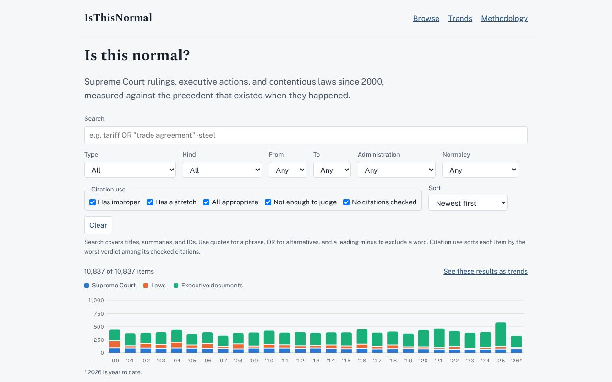

# IsThisNormal

<!-- site-summary:start -->
<!-- This section is this project's card on https://mendus59.github.io and is copied there daily.
     Keep it true of what's on main: one plain-text summary line (max 160 characters), then 1-6 short bullets.
     See CLAUDE.md ("Site summary"). -->
Is a Supreme Court ruling, executive action or contentious law "normal"?

- Measures each ruling, executive action and contentious law since 2000 against the precedent, statute text and public data that existed when it happened.
- Gives each item a short plain-language summary of what it does or decides.
- Free daily ingestion of public records (Federal Register, Congress, Supreme Court opinions) into a citation graph.
- New entries are scored automatically each day against versioned rubrics, within a small daily budget.
- Marks each checked citation as appropriate, a stretch, or improper, with the reason, and flags and filters items that cite improperly.
- Shows each item's full text as clean paragraphs, with laws and orders laid out by section and subsection.
<!-- site-summary:end -->

<!-- site-screenshot: docs/screenshot.jpg -->

Is a Supreme Court ruling, executive action, or contentious law "normal"? This
project measures each one since 2000 against the precedent, statute text,
comparable actions, and public data that existed when it happened.

- **`web/`**: the static site (Astro), deployed to GitHub Pages. No cookies or analytics.
- **`pipeline/`**: the `itn` command: free ingestion of public records, export to
  static files, and paid AI analysis that only runs when you start it.
- **`schema/`**: Postgres migrations.
- **`rubrics/`**, **`calibration/`**: versioned scoring rubrics and anchor artifacts (phase 4).

Data lives in Cloudflare R2 (documents and published files) and Neon Postgres
(citation graph and analyses). See [SETUP.md](SETUP.md) to connect them.

## Workflows

| Workflow | Trigger | Spends money? |
|---|---|---|
| Ingest | daily, or by hand | no |
| Publish data | daily, after Analyze, or by hand | no |
| Analyze | by hand only, after you approve the `paid` environment | yes, up to the budget you set |
| Deploy site | changes under `web/` | no |
| CI | pull requests | no |

## Status

Phase 1: storage, schema, workflows, Federal Register ingestion, and a browse
page. Next: Congress.gov and GovInfo laws with vote-based contentiousness, then
Supreme Court opinions and citation extraction.
